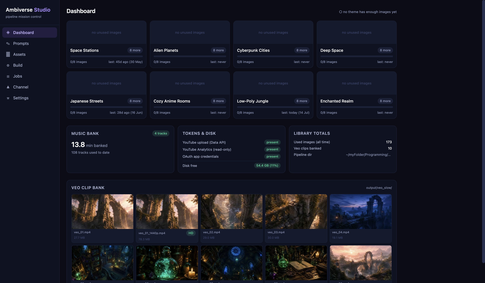
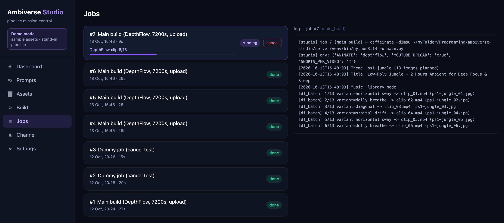
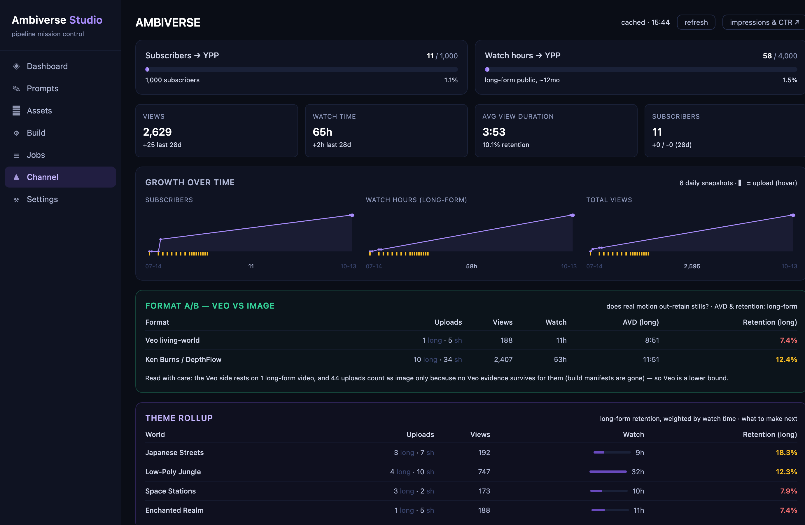
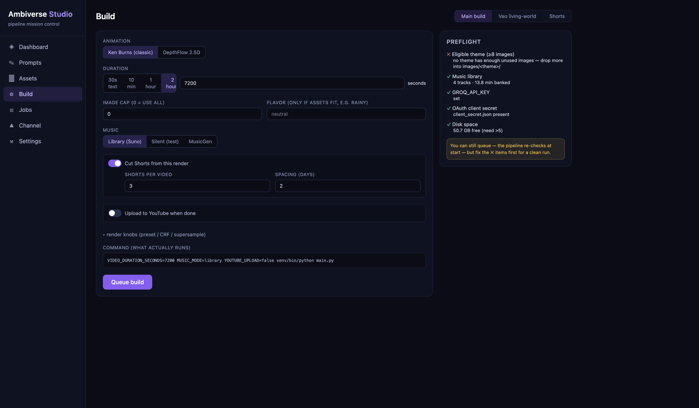
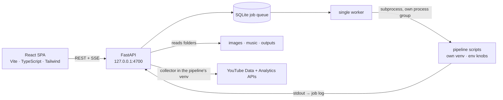

# Ambiverse Studio

[](https://github.com/olkuznetsov/ambiverse-studio/actions/workflows/ci.yml)
[](LICENSE)

**Mission control for an AI content pipeline.** A local FastAPI + React app that replaced ~20 CLI scripts and their environment-variable knobs with one UI: live pipeline state, a job queue with streaming logs and real progress bars, a media browser, and channel analytics that answer a question instead of dumping numbers.

It drove [Ambiverse](https://www.youtube.com/@ambiverseworlds), a YouTube channel of 2-hour ambient "worlds" made from AI-generated images, Veo clips and Suno music: ffmpeg assembly, DepthFlow 2.5D parallax, Real-ESRGAN upscaling and RIFE frame interpolation, then automated metadata, thumbnails and scheduled uploads.

> **Status (October 2026):** the channel is on hiatus, so this is a finished reference implementation. It ships a **demo mode**: clone, run one command, and every page and job type works — no API keys, no private pipeline, no YouTube account.



## Try it

```bash
git clone https://github.com/olkuznetsov/ambiverse-studio
cd ambiverse-studio
make demo        # then open http://127.0.0.1:4700
```

Needs Python 3.12+ and Node 22 (or 20.19+). ffmpeg is optional; with it the demo also renders small real videos. The first start takes ~10 seconds while sample assets are generated.

Things to try:

- **Build → Main build** — pick DepthFlow, switch on upload, queue it. **Jobs** streams the log with a progress bar through rendering, Shorts and a simulated upload; the results land in **Assets → Outputs**.
- **Jobs** — cancel a running job: its whole process group dies, grandchildren included.
- **Prompts** — copy-ready image and music prompts; *Generate fresh prompts* runs as a job.
- **Channel** — a frozen snapshot of the real channel's analytics.

**Jobs** — a demo build mid-run. The bar is parsed from the pipeline's own log markers, the log streams over SSE, and cancel stops the whole process group.



**Channel** — the real channel's analytics: YPP progress, growth with upload markers, a Veo-vs-image comparison that states its own limits, and the per-world rollup.



**Build** — every knob of the main build, the exact command it will run, and an inline preflight.



## What it does

| Page | |
|---|---|
| **Dashboard** | "Can I build today?" — per-world image readiness, music bank, clip bank, token and disk status, running-job banner. |
| **Prompts** | Daily prompt generation as a job; one click copies `style + scene + variation` for the image model. |
| **Assets** | Image grid with input warnings, music playback, outputs browser with video preview over HTTP range requests, housekeeping that finds reclaimable gigabytes. Deletes move to a recoverable trash. |
| **Build** | Wizards that assemble the env and **show the exact command** before running it, with an inline preflight: main build, Veo enhance → assemble → publish, Shorts builder. |
| **Jobs** | SQLite queue, single-flight renders, live logs over SSE, per-phase progress (render, ESRGAN frames, reels, upload chunks), process-group cancel, desktop notification when a long job ends. |
| **Channel** | YPP progress, growth over time with upload markers, a Veo-vs-image format comparison and a per-world retention rollup ("what to make next"), traffic/geo/devices, scheduled uploads, a manual impressions/CTR log. |
| **Settings** | Paths, the pipeline's live defaults, token status with re-auth jobs, the theme registry. |

## How it works



- **Wrap, don't rewrite.** Jobs run the pipeline's own scripts exactly as the CLI does — its interpreter, its working directory, a whitelist of env knobs. No pipeline logic is duplicated, and the pipeline still works without the studio.
- **Job engine.** One worker drains the queue so multi-hour renders never compete for 16 GB of RAM. Each job gets its own process group (and `caffeinate` on macOS); cancel is SIGTERM → grace → SIGKILL to the whole group, so ffmpeg and RIFE children die too.
- **Progress from the pipeline's own log markers** (`clip 7/20 done`, `[esrgan] 24/48`, `[upload] 61%`). Best-effort by design: the raw log is always shown next to the bar.
- **Analytics collector** runs as a subprocess under the pipeline's venv (it needs the Google client libraries), reuses the pipeline's helpers, and is cached for an hour to stay inside API quotas.
- **Demo mode** swaps the private pipeline for `demo/pipeline/`, a stand-in that speaks the same CLI and log protocol, plus generated scenes, ambient pads and clips. The studio can't tell the difference: every job runs through the real engine, parser and log stream.

## Engineering notes

- **Honest metrics.** YPP watch hours count long-form only, as YouTube does. Retention is compared across long-form videos only — Shorts loop, so their view rate can exceed 100% and would make any group with many Shorts look several times better. Each upload's world and format carry their evidence source (build manifest → the pipeline's run logs → keyword guess), and the UI marks guesses and states when a comparison rests on too little data.
- **Localhost, actually locked down.** Binds 127.0.0.1 and accepts only local `Host` headers (DNS rebinding). File serving resolves paths before checking them, so `../` can't escape; media endpoints serve media extensions only; tokens appear as status, never contents.
- **Tested.** 41 tests run in demo mode with no network: the security claims above, the job lifecycle including a cancel that must kill a grandchild process, the progress parser, and a full build end to end. CI runs them on every push, plus lint, typecheck and build for the web app.

## How it was built

Built with Claude Code in two coordinated sessions: one on the private pipeline, one on this app. [docs/PLAN.md](docs/PLAN.md) set seven milestones from read-only dashboard to analytics; [HANDOFF.md](HANDOFF.md) is the contract between the sessions — when the pipeline gained a script or knob, it logged what the studio should surface; [CLAUDE.md](CLAUDE.md) holds the working rules. The roadmap that followed is in [docs/IDEAS.md](docs/IDEAS.md).

## Layout

```
server/           FastAPI app: job engine, progress parser, inventory readers, media, routes
server/collectors YouTube collector (runs in the pipeline's venv)
server/tests      pytest suite (demo mode)
demo/pipeline     stand-in pipeline for demo mode
demo/fixtures     frozen channel snapshot, real prompt run, theme registry
web/              React SPA
```

## Development

```bash
make dev      # API with autoreload on :4700
make web      # Vite on :5175, proxies /api to :4700
make test     # pytest + web lint, typecheck, build
```

To drive a real pipeline, set `ANIMEMBIENT_DIR` in `.env` (see [.env.example](.env.example)). Without it the studio runs in demo mode.

## License

[MIT](LICENSE)
